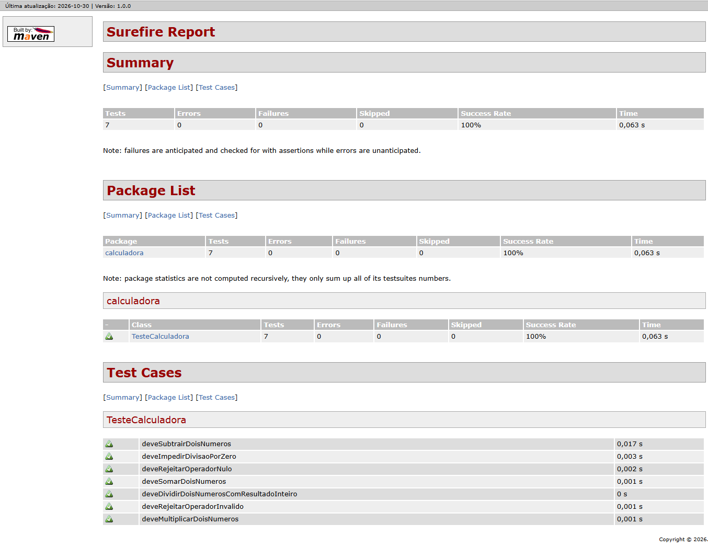
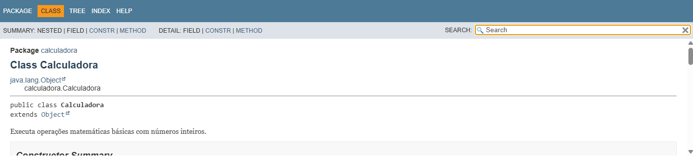

# Projeto Calculadora — FinançApp

> Projeto acadêmico desenvolvido com foco em qualidade de software, testes, refatoração, documentação e versionamento.

---

## 1. Identificação do Projeto

**Projeto:** Projeto Calculadora  
**Contexto:** FinançApp  
**Aluno:** Nicolas Godoy  
**RA:** 251194  
**Curso:** Análise e Desenvolvimento de Sistemas  
**Disciplina:** UX/UI e Testes de Software  
**Professor:** Daniel Ohata  
**Semestre:** 2026.2  

---

# 2. Visão Geral

O projeto implementa um módulo de cálculos matemáticos básicos em Java para a startup fictícia **FinançApp**. A calculadora pode apoiar funcionalidades futuras de controle financeiro, como orçamento mensal, divisão de despesas, projeções de economia e cálculos auxiliares.

Além das operações, o projeto contempla testes automatizados, tratamento de erros, documentação técnica e preparação para versionamento.

---

# 3. Problema

A aplicação FinançApp precisa de um módulo matemático reutilizável, legível e confiável. O desafio é implementar as operações solicitadas e tratar entradas inválidas de forma previsível, facilitando testes e manutenção.

---

# 4. Objetivo

## 4.1 Objetivo Geral

Desenvolver uma calculadora em Java aplicando práticas de qualidade, testes, documentação, refatoração e versionamento.

## 4.2 Objetivos Técnicos

- Implementar operações matemáticas básicas com números inteiros.
- Tratar operador inválido e divisão por zero.
- Desenvolver testes automatizados com JUnit.
- Refatorar o código sem alterar seu comportamento.
- Documentar classes e métodos com JavaDoc.
- Gerar documentação HTML.
- Organizar o projeto e seus artefatos de versionamento.

---

# 5. Escopo Funcional

| ID | Funcionalidade | Descrição | Status |
|---|---|---|---|
| RF01 | Soma | Soma dois números inteiros | Implementado e testado |
| RF02 | Subtração | Subtrai dois números inteiros | Implementado e testado |
| RF03 | Multiplicação | Multiplica dois números inteiros | Implementado e testado |
| RF04 | Divisão | Divide dois números inteiros com resultado inteiro | Implementado e testado |
| RF05 | Validação de divisão | Impede divisão por zero com exceção controlada | Implementado e testado |
| RF06 | Operação inválida | Rejeita operadores não suportados com mensagem | Implementado e testado |

A divisão entre inteiros descarta a parte fracionária e trunca o resultado em direção a zero, conforme o comportamento do operador `/` para inteiros em Java. Por exemplo, `9 / 2` resulta em `4`.

---

# 6. Requisitos Não Funcionais

| ID | Categoria | Requisito |
|---|---|---|
| RNF01 | Qualidade | Código organizado e legível |
| RNF02 | Testabilidade | Operações e erros cobertos por testes unitários |
| RNF03 | Manutenção | Código preparado para refatoração sem alteração funcional |
| RNF04 | Documentação | Classes e métodos documentados com JavaDoc |
| RNF05 | Versionamento | Projeto preparado para Git e GitHub |
| RNF06 | Confiabilidade | Erros tratados por exceções com mensagens compreensíveis |

---

# 7. Tecnologias Utilizadas

| Tecnologia | Versão/Configuração | Utilização |
|---|---|---|
| Java | Eclipse Temurin JDK 17.0.20.1 | Desenvolvimento |
| JUnit Jupiter | 5.10.2 | Testes unitários |
| Apache Maven | 3.9.16, extraído no perfil do usuário | Build e execução dos testes |
| Git for Windows MinGit | 2.56.0.windows.4, extraído no perfil do usuário | Controle de versão |
| JavaDoc | JDK 17.0.20.1 | Documentação HTML |
| IDE | Visual Studio Code | Ambiente de desenvolvimento |

---

# 8. Estrutura do Projeto

```text
projeto_calculadora/
├── src/
│   ├── main/java/calculadora/Calculadora.java
│   └── test/java/calculadora/TesteCalculadora.java
├── docs/                         # Documentação JavaDoc gerada
├── scripts/
│   ├── generate-javadoc.ps1
│   └── test.ps1
├── images/
│   ├── testes/
│   │   ├── testes-main.png
│   │   └── testes-refatoracao.png
│   └── javadoc/
│       └── javadoc-calculadora.png
├── pom.xml
├── README.md
└── .gitignore
```

---

# 9. Operações e Tratamento de Erros

A classe `calculadora.Calculadora` expõe o método `calc(int a, int b, String op)`, que aceita os operadores `+`, `-`, `*` e `/`.

- Operadores não suportados ou nulos resultam em `IllegalArgumentException`.
- Divisão por zero resulta em `ArithmeticException`.
- A divisão inteira segue a regra de truncamento do Java.

O chamador deve capturar essas exceções e apresentar as mensagens ao usuário, evitando que erros não tratados encerrem a aplicação.

---

# 10. Como Compilar e Executar os Testes

As ferramentas portáteis usadas nesta máquina estão em `%LOCALAPPDATA%\Programs\FinancAppTools`; não foi necessário instalá-las no Windows nem alterar o `PATH` global. Os scripts abaixo preparam o ambiente apenas para o processo executado.

Na raiz do projeto, execute:

```powershell
.\scripts\test.ps1
```

Os testes estão em `src/test/java/calculadora/TesteCalculadora.java`. O Maven apresenta os resultados e as falhas com valores esperados e obtidos pelas asserções.

**Resultado verificado:** 7 testes executados, 0 falhas, 0 erros e 0 testes ignorados. O relatório está em `target/surefire-reports/calculadora.TesteCalculadora.txt`.

---

# 11. JavaDoc

Gere ou atualize os arquivos HTML a partir da raiz do projeto:

```powershell
.\scripts\generate-javadoc.ps1
```

A documentação foi gerada com JDK 17.0.20.1. A página inicial está em [`docs/index.html`](docs/index.html). O código-fonte contém JavaDoc para a classe e o método público.

---

# 12. Testes e Evidências

Os testes implementados cobrem soma, subtração, multiplicação, divisão inteira, divisão por zero, operador inválido e operador nulo.

**Testes na branch `main`:** 7 testes, 0 falhas e 0 erros.



**Testes na branch `Refatoracao`:** 7 testes, 0 falhas e 0 erros.


**Documentação JavaDoc:** página da classe `Calculadora`, gerada em `docs/index.html`.



---

# 13. Refatoração e Versionamento

O repositório local possui duas branches:

- `main`: implementação funcional inicial, usando condicionais para selecionar as operações; commit `1530b81` (`feat: implementa calculadora e testes`).
- `Refatoracao`: seleção simplificada com `switch` e divisão extraída para um método privado; testes executados novamente com sucesso.

As duas versões passaram pelos 7 testes. O repositório remoto foi criado no GitHub e está configurado neste projeto.

Para conferir o histórico local:

```powershell
& "$env:LOCALAPPDATA\Programs\FinancAppTools\git\cmd\git.exe" branch -vv
& "$env:LOCALAPPDATA\Programs\FinancAppTools\git\cmd\git.exe" log --oneline --all
```

**Link do repositório GitHub:** https://github.com/Nigodoy250107/projeto_calculadora

---

# 14. Entrega e Pendências

O código-fonte, configuração Maven, testes, JavaDoc e capturas de evidência estão incluídos no repositório.
